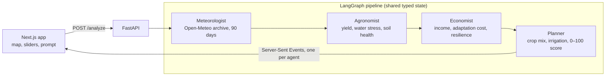

# SCDS: Smart Climate Decision System

**Winner, WashU Skandalaris AI Hackathon 2025** (Hack WashU × Skandalaris Center × Mayfield)

Pick any place on a map and SCDS tells you how the climate there is changing, what it means for local farming and the economy, and which adaptation strategy fits your priorities. A team of AI agents works through it step by step, and you watch their reasoning arrive in the browser as it streams in.

SCDS has two modes:

- **Agricultural adaptation.** Four agents (Meteorologist → Agronomist → Economist → Planner) turn the last 90 days of real weather data into a crop mix and water strategy, scored against your economic, environmental and social priorities.
- **Long-term climate risk.** Analyst agents estimate climate hazards, economic impact and an overall risk score for a location over the next N years.

## How it works



**Numbers come from models; language comes from the LLM.** Every quantitative output is computed by deterministic, testable code, and GPT-4o-mini is used only to explain it. That keeps the results reproducible and stops the LLM from inventing figures.

- **Meteorologist** pulls 90 days of daily temperature and precipitation from the [Open-Meteo archive API](https://open-meteo.com/), computes the precipitation anomaly against a seasonal baseline, and classifies drought, heat and flood risk.
- **Agronomist** estimates crop yield change, a water-stress index and a soil-health index from those signals, then writes an LLM summary for farmers.
- **Economist** converts the agronomic signals into income change, adaptation cost, economic resilience and employment impact.
- **Planner** builds a strategy (crop mix across maize, sorghum and legumes, plus irrigation, water harvesting and soil improvements), simulates its impact on food, income, emissions and risk, and scores it 0–100 using your normalized priority weights.

Agents pass information to each other as **structured claims** (`metric`, `value`, `unit`, `confidence`) in a shared Pydantic state, not free text. Each agent reads exactly the numbers it needs from the agents before it, and the UI can show where every number came from in the "Explain" view.

## Features

- Interactive Google Map: search a place, enter coordinates, or click anywhere; set an area radius of 10–200 km
- Priority sliders for economic, environmental and social goals that change the recommended strategy
- Optional free-text context (for example, "focus on smallholder farmers")
- Agent debate feed streamed over Server-Sent Events
- KPI cards and charts for rainfall and yield projections
- "Explain" view with data sources and reasoning for each claim
- Long-term risk mode with an adjustable time horizon

## Tech stack

| Layer | Tools |
|---|---|
| Frontend | Next.js 15 (App Router), React 19, TypeScript, Tailwind CSS, shadcn/ui, Framer Motion |
| Maps and charts | Google Maps JavaScript API and Geocoding, Chart.js |
| Backend | FastAPI, Pydantic v2, Server-Sent Events |
| Agents | LangGraph, LangChain, OpenAI GPT-4o-mini |
| Data | Open-Meteo historical weather archive |
| Deployment | Vercel (frontend), Render (backend) |
| Testing | pytest, pytest-asyncio |

## Getting started

### Prerequisites

- Node.js 18+ and Python 3.11+
- An OpenAI API key
- A Google Maps API key with the Maps JavaScript API and Geocoding API enabled

### 1. Backend

```bash
cd backend
python3 -m venv venv
source venv/bin/activate        # Windows: venv\Scripts\activate
pip install -r requirements.txt
```

Create `backend/.env`:

```env
OPENAI_API_KEY=your_openai_api_key
# Optional: override the agronomist's model
# AGRONOMIST_MODEL=gpt-4o-mini
```

Run it:

```bash
python main.py                  # or: uvicorn main:app --reload --port 8000
```

### 2. Frontend

```bash
npm install --legacy-peer-deps
```

Create `.env.local` in the project root:

```env
NEXT_PUBLIC_GOOGLE_MAPS_API_KEY=your_google_maps_key
BACKEND_URL=http://localhost:8000
```

Run it:

```bash
npm run dev
```

Then open [http://localhost:3000](http://localhost:3000).

## API

### `POST /analyze` (agricultural adaptation)

```json
{
  "location": { "lat": -1.286, "lng": 36.817, "name": "Nairobi" },
  "radius": 100,
  "priorities": { "economic": 50, "environmental": 50, "social": 50 },
  "userPrompt": "Focus on smallholder farmers"
}
```

The response is a Server-Sent Events stream with one message per agent, followed by the final strategy:

```
data: {"role": "meteorologist", "content": "...", "claims": [...], "recommendations": [...]}
data: {"role": "agronomist", ...}
data: {"role": "economist", ...}
data: {"role": "planner", ...}
data: {"role": "system", "content": "Analysis complete", "strategy": {...}, "impact": {...}}
```

### `POST /analyze-risk` (long-term risk)

Takes a location, a time horizon in years and an optional prompt, and streams risk-analyst and economist assessments plus a risk score and impact estimate.

### `GET /`

Health check.

## Project structure

```
├── src/                              Next.js frontend
│   ├── app/
│   │   ├── page.tsx                  Agricultural adaptation mode
│   │   ├── climate-risk/page.tsx     Long-term risk mode
│   │   ├── landing/page.tsx          Landing page
│   │   └── api/                      Proxies to the FastAPI backend
│   │       ├── analyze/route.ts
│   │       ├── analyze-risk/route.ts
│   │       └── health/route.ts
│   ├── components/                   Map, debate feed, KPI cards, charts, sliders, explain modal
│   ├── lib/                          Google Maps geocoding, Open-Meteo client, API client
│   └── types/api.ts                  Shared request and response types
│
└── backend/                          FastAPI + LangGraph
    ├── main.py                       API server and SSE streaming
    ├── graph.py                      LangGraph pipeline
    ├── agents/                       meteorologist, agronomist, economist, planner
    ├── models/schemas.py             Pydantic state, claims and request models
    ├── tests/                        Agent and full-pipeline tests
    └── render.yaml                   Render deployment config
```

## Testing

```bash
cd backend && pytest            # agent unit tests and full-pipeline test
npm run lint                    # frontend lint and type checks
./test-local.sh                 # end-to-end check against local servers
./test-deployment.sh            # end-to-end check against the deployed app
```

## Limitations and next steps

- The precipitation baseline is a fixed seasonal estimate. Using a per-location 30-year climatology would make the anomaly more accurate.
- The pipeline currently runs to completion and then streams each agent's message. Streaming tokens as each agent works is next.
- Planned: FAOSTAT crop-yield and price data, OR-Tools multi-objective crop-mix optimization, multi-region comparison, and response caching.

## Team

Built at the WashU Skandalaris AI Hackathon 2025. Henry He was technical lead and designed the multi-agent architecture, the FastAPI and LangGraph backend, and the streaming integration with the frontend. Teammates shaped the product direction and user experience and delivered the final pitch.

## License

MIT
